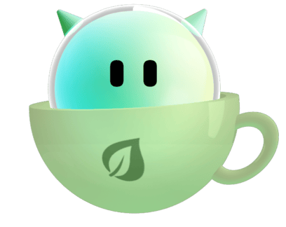

<!-- header:begin (generated from project metadata) -->
<h1 align="center">Gitea Mirror</h1>

<p align="center">
  
</p>

---

<p align="center">
  <a href="https://paypal.me/seb5594"></a>
  <a href="https://buymeacoffee.com/seb5594"></a><br>
  <a href="https://my.home-assistant.io/redirect/supervisor_add_addon_repository/?repository_url=https%3A%2F%2Fgithub.com%2Fseb5594%2FHome-Assistant-Apps"></a>
  <a href="https://github.com/seb5594/Home-Assistant-Gitea-Mirror-App/releases/tag/v3.51.7"></a>
  <br>
  
  
  <br>
  <a href="https://github.com/seb5594/Home-Assistant-Apps/issues"></a>
  
  <a href="https://github.com/seb5594/Home-Assistant-Gitea-Mirror-App/actions/workflows/ci.yml"></a>
  <a href="https://github.com/seb5594/Home-Assistant-Apps#license"></a>
</p>
<!-- header:end -->

Brings [Gitea Mirror](https://github.com/RayLabsHQ/gitea-mirror) to Home Assistant. It mirrors
repositories from GitHub, GitLab or another Gitea to your own Gitea and keeps them up to date. The
original web interface is the page of the app, so there is nothing to open on your network.

> **Experimental Home Assistant wrapper.** The app version follows the packaged upstream image.
> This does not change the wrapper's testing status. Please report what you see.

* **Inside Home Assistant.** The web interface opens through ingress and signs you in with your
  Home Assistant account.
* **Made for the Gitea app.** The address of the [Gitea app by alexbelgium](https://github.com/alexbelgium/hassio-addons/tree/master/gitea)
  is already filled in. At every start the log checks Gitea and your token, and takes the Gitea user
  name and the address of your browser from it.
* **Every variable is an option.** All environment variables of Gitea Mirror can be set on the
  configuration page, in English and German. What you leave empty stays in the hands of the web
  interface.
* **Pinned and followed.** The release of Gitea Mirror is pinned, never `latest`. A scheduled
  workflow follows minor and patch releases within the current major and uses the same app version.

## Install

In Home Assistant open **Settings → Apps → App store → ⋮ → Repositories**, add
`https://github.com/seb5594/Home-Assistant-Gitea-Mirror-App` and install **Gitea Mirror**.
Older versions call these *Add-ons* and *Add-on store*. Setup, options and troubleshooting are in the
[documentation](gitea_mirror/DOCS.md).

## How it fits together

```text
Home Assistant ──ingress──► ingress-server ──► Gitea Mirror (Bun, SQLite in /data)
 (your account)                 │                  │
                                │                  ├──► source: GitHub, GitLab, Gitea
                                └ user headers     └──► destination: your Gitea
```

The app takes the official release unchanged. The start script turns the options into the
environment of Gitea Mirror, checks Gitea, creates the secrets and starts it; a small server in
front removes the ingress path and lets only Home Assistant through.

## Development

```text
gitea_mirror/
  config.yaml, translations/    options and their labels
  rootfs/usr/lib/gitea-mirror/  shell libraries: options to environment, Gitea check
  rootfs/usr/share/gitea-mirror/
    env-map.json                which option sets which variable
    ingress-server.ts           the server in front of the application
  rootfs/etc/s6-overlay/        the service
.github/tests/runtime.sh        runs inside the built image
.github/workflows/upstream.yml  follows the releases of Gitea Mirror
```

The runtime test starts the real application behind a fake ingress path, signs in with the headers
Home Assistant adds and gives it its configuration. It also checks that every variable in
`env-map.json` is still read by the release in the image, so an upstream rename fails the build and
not an installation. The shared engine's `.scripts/upstream.py` updates the primary image pin,
synchronizes the app version, and adds a changelog entry. Major updates require approval as described below.

## Upstream versions and update approval

The app version and Dockerfile `BUILD_VERSION` match `GITEA_MIRROR_VERSION` without a leading `v`. The daily follower applies only minor and patch releases within the installed upstream major. Major Docker updates first wait for your approval in Renovate's **Dependency Dashboard**; after approval, review the generated PR and upstream breaking changes, then merge it manually. Automerge is explicitly disabled for those major PRs.

The policy lives in `.github/upstream.json` and is enforced by the shared engine, including when managed Renovate files are regenerated. Dependabot handles GitHub Actions only. Base-image or package-only updates do not invent a new upstream version; they are included in the next upstream app release. Historical Alpha versions remain in the changelog.

<!-- support:begin (generated, shared text) -->
## Say thanks

All my projects are built in my spare time, just for the fun of it. Still, they take a lot of time and care, and many of the smart home gadgets I buy end up here because I want to make them cloud-free and smart-home ready. Every bit of support means a lot to me.

If my work helped you or turned out to be useful, show your appreciation with a hot drink for my next sleepless night.

[](https://paypal.me/seb5594) [](https://buymeacoffee.com/seb5594)
<!-- support:end -->

<!-- license:begin (generated from the license file) -->
## License

[](LICENSE)

Published under the [MIT License](LICENSE).
<!-- license:end -->
